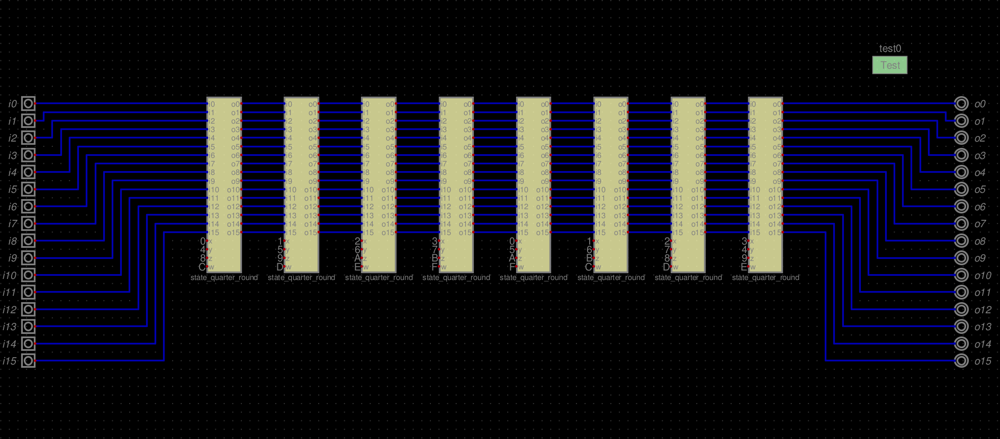
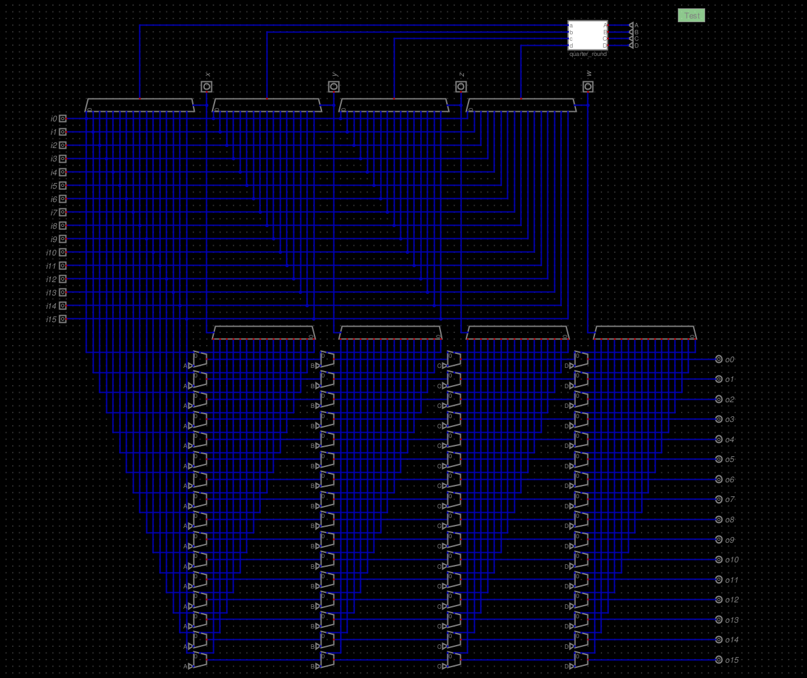
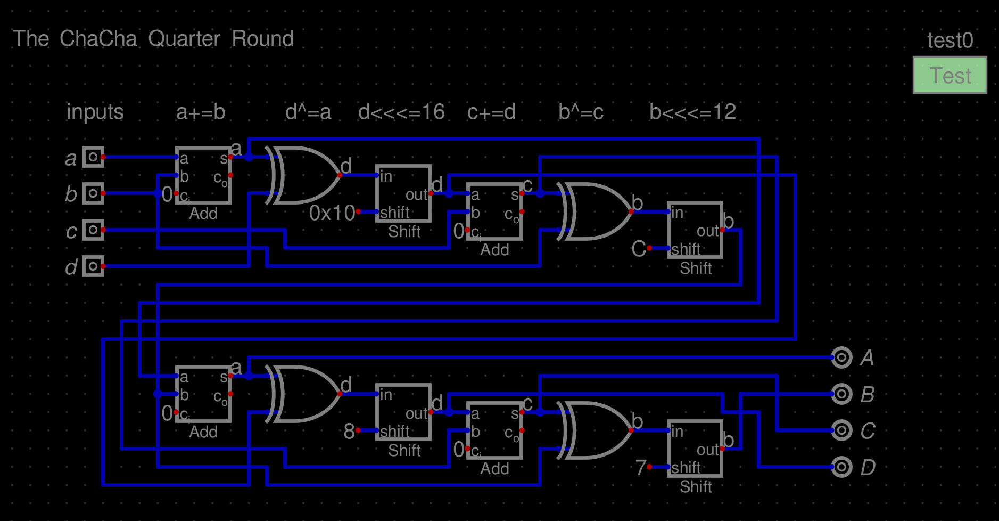
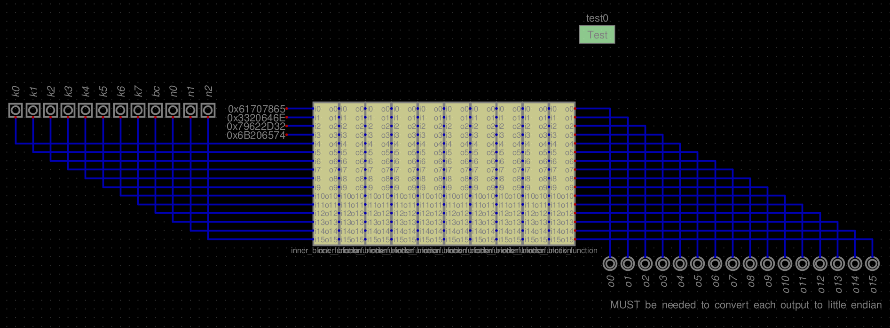

# [WIP] ChaCha20 Algorithm implemented in hardware

## References

- https://www.rfc-editor.org/info/rfc8439/
- https://en.wikipedia.org/wiki/ChaCha20-Poly1305
- https://lnkd.in/p/emWu7Mmf
- https://github.com/hneemann/Digital
- https://github.com/hugoocoto/chacha2

